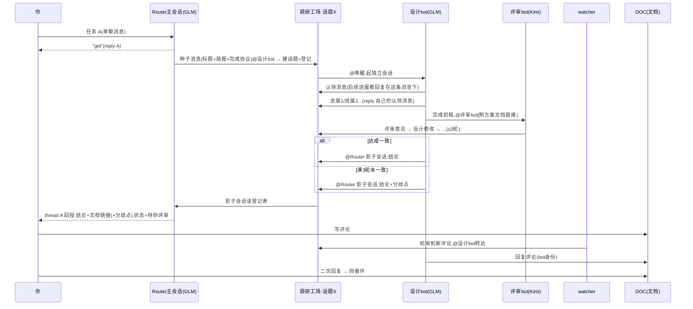
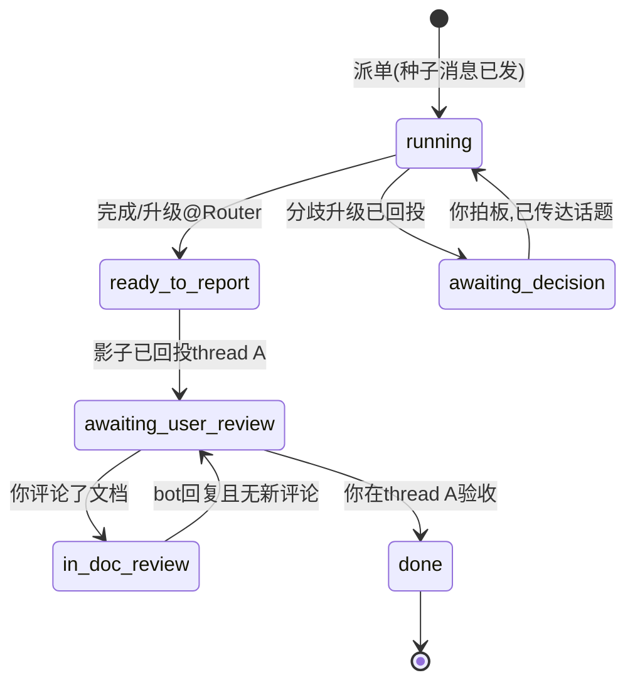
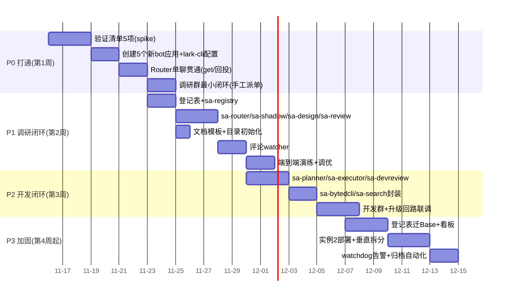

# Super-agent 个人落地方案

> 版本 v1(2026-11-13)。基于《Super-agent 设计探索》文章 + `dsh-superagent-prototype` 源码研读 + 本机环境实测(botmux 3.59.10 / herdr 0.9.5 / Claude Code+Codex 已配 GLM / lark-cli 1.0.97)编写。
>
> 全文遵守统一术语表(附录 A),同一概念在全文只用同一个名字。

---

## 0. 结论速览

**总体判断:不部署 dsh-superagent 原型(它绑定 DeepSeek Harness 运行时),而是把它的域模型移植到你现有的 botmux + herdr + Claude Code/Codex 栈上。自建量很小:6 个飞书机器人应用 + 一套角色 Skill + 一个约 100 行的评论巡检脚本,不需要引入任何新的 agent 框架。**

| 决策点 | 结论 | 一句话理由 |
|---|---|---|
| D1 总体路线 | 移植域模型,不移植代码 | dsh 依赖 DSH 运行时;botmux 已提供 IM↔CLI 桥、多 bot、按话题隔离的会话,正好是 Worker 层 |
| D2 Router 形态 | Router bot 与你的**单聊**是唯一入口;Router 层 = 主会话 + 各 worker 群里的影子会话 + 任务登记表 | botmux 会话按群/话题隔离,跨群 @ 会另起无上下文会话(官方文档明示);登记表做全局状态,对应文章"Router 层内部可以不局限单会话" |
| D3 派单机制 | worker 群建为**话题群**,任务种子消息(顶层)= 新话题,@ 角色 bot 开工 | 话题群顶层消息天然成话题;`botmux send --chat-id` 跨群发布是官方支持路径;`dispatch` 只能在当前群开话题,与"分群"诉求冲突 |
| D4 回报机制 | 双通道:话题里 @router(即时)+ 写登记表(对账) | 即时性靠 @ 唤醒影子会话,可靠性靠登记表 + 定时巡检兜底 |
| D5 文档评论回路 | 轮询 watcher(lark 事件总线**没有** drive 域,已实测) | 3 分钟级延迟可接受;watcher 兼职 Watchdog |
| D6 模型分配 | Router/设计/Planner/Executor=GLM,评审类=Kimi,巡检=DeepSeek | 额度排序 × 角色负载;评审用异构模型互相挑错是收益点 |
| D7 容量结论 | 2C/8G/80G 单实例可跑 **4–6 个并发活跃任务会话**(executor 同时 ≤2);磁盘够 30–60 个任务工作区 | 瓶颈是 CPU(编译/自测)不是内存;80GB 充足 |
| D8 多实例 | 任务登记表升级为**飞书多维表格(Base)** 做共享状态;botmux team scope + herdr remote 跨机 | 存算分离的落地形态:Base=状态,实例=算力,飞书=总线 |

**建设节奏**:4 期(P0 打通 → P1 调研闭环 → P2 开发闭环 → P3 分布式),每期都能独立用起来,详见第 8 章甘特图。

---

## 1. 目标与统一概念

### 1.1 你要的两条工作流(原文需求回收)

**流程 R(方案调研)**:你在 Router 会话发任务 A → Router bot 回 "get" → 路由到某调研 worker 群开话题 → 群内**设计 bot**认领并持续汇报进展 → 完成后 @**评审 bot** → 两 bot 讨论至一致或满 3 轮 → Router 在任务 A 的线程(thread A)回投结论 + 方案文档链接(含未决分歧点)→ 你在文档上评论 → worker 群 bot 感知并回复 → 你的二次回复同理循环。

**流程 D(开发实现)**:你在 thread A 回复"开始实现" → Router 路由到开发 worker 群 → **Planner bot** 新起话题,把方案文档细化成 Spec 并 @**开发评审 bot** → 两 bot 讨论至一致或 3 轮,不决点经 Router 在 thread A 请你拍板(附文档链接)→ 确认后 **Executor bot** 开发 + 自测(用 search platform / bytedcli 等 skill)→ @开发评审 bot 比对 Spec 与实现 → 讨论与自动修复,一致或 3 轮,不决点升级给你。

### 1.2 统一术语(全文唯一命名,附录 A 有速查)

| 术语 | 定义 |
|---|---|
| **Router bot / Router 会话** | 唯一入口机器人应用;Router 会话 = 你与它的**单聊** |
| **thread A** | 你在 Router 会话里发起任务 A 的那条消息的回复线程,一切回投/升级/拍板都发生在 thread A |
| **worker 群** | 按任务类型划分的**话题群**(飞书 chat_mode=topic),如"调研工场""开发工场" |
| **话题** | worker 群内一个任务的可观察协作现场(= 一条顶层种子消息及其回复) |
| **角色 bot** | 具备某角色 Skill 的机器人应用:设计 / 评审(调研用);Planner / Executor / 开发评审(开发用) |
| **任务登记表** | 全局唯一事实源,记录任务→话题→文档→状态;P0–P2 为本地 JSON,P3 升级为飞书多维表格 |
| **主会话 / 影子会话** | Router bot 在 Router 会话里的常驻会话叫主会话;在各 worker 群里被 @ 唤起的临时会话叫影子会话 |
| **方案文档 / Spec 文档 / 自测报告** | 三类标准产物,均为飞书云文档,命名见第 5 章 |
| **完成协议 / 升级协议** | 角色 Skill 里写死的收尾规则:完成后 @router + 写登记表;分歧满 3 轮必须升级,禁止继续 |
| **评论 watcher** | 自建巡检脚本:轮询活跃文档的新评论并转达进话题,兼做 Watchdog |

### 1.3 与文章/repo 概念的映射(为什么这样移植)

| dsh-superagent 概念 | 本方案对应物 | 说明 |
|---|---|---|
| Source / Trigger | 飞书消息事件(botmux 接收) | botmux 即 Source,消息即 Trigger |
| Thread | 飞书话题 / thread A | 语义一致 |
| Eval(准入+研判) | Router 主会话的路由决策 | 文章结论:Router 用轻模型即可 |
| Ticket | 任务登记表中的一行 | 状态机见 4.4 |
| Executor Session | worker 群话题里的角色 bot 会话 | botmux 按话题起独立会话,天然上下文隔离 |
| Subscription(订阅直通) | 话题内 @ 与 botmux 会话绑定 | 同话题后续消息自动进入该 bot 会话 |
| Outbox(可靠外发) | 影子会话回投 + 巡检兜底 | 弱化版,个人规模够用 |
| Panel(看板) | 任务登记表(Base 视图)+ herdr attach | Base 视图即看板;herdr 能直接附身任何会话 |
| Watchdog | 评论 watcher + 定时巡检任务 | 文章第 6 节的 Control Loop |

---

## 2. 总体架构

### 2.1 架构图

```mermaid
flowchart TB
    subgraph Feishu["飞书(事件总线 + 可观察现场)"]
        RC["Router 会话(单聊)\nthread A:任务/回投/拍板"]
        WG1["worker 群:调研工场(话题群)\n每任务一个话题"]
        WG2["worker 群:开发工场(话题群)\n每任务一个话题"]
        DOC["飞书文档(方案/Spec/自测)\n+ 你的评论"]
        BASE["任务登记表(Base/JSON)"]
    end

    subgraph Host["云容器实例(2C/8G/80G)"]
        BM["botmux daemon\n6 个 bot 应用长连接"]
        HD["herdr(会话宿主)"]
        subgraph Sessions["Claude Code / Codex 会话"]
            RS["Router 主会话(GLM)"]
            SS["Router 影子会话"]
            DB_["设计 bot 会话(GLM)"]
            RB["评审 bot 会话(Kimi)"]
            PB["Planner 会话(GLM)"]
            EB["Executor 会话(GLM)"]
            DR["开发评审会话(Kimi)"]
        end
        WT["评论 watcher\ncron 每 3 分钟"]
    end

    you(("你")) -->|任务 A| RC
    RC --- RS
    WG1 --- DB_ & RB & SS
    WG2 --- PB & EB & DR & SS
    BM --- Sessions
    HD --- Sessions
    WT -->|新评论→话题@| WG1 & WG2
    WT --> BASE
    DOC <-.->|轮询/回复| WT
    RS -->|登记| BASE
    SS -->|登记| BASE
```

### 2.2 流程 R(方案调研)时序



### 2.3 流程 D(开发实现)时序

```mermaid
sequenceDiagram
    participant U as 你
    participant R as Router主会话
    participant T as 开发工场·话题Y
    participant P as Planner(GLM)
    participant V as 开发评审(Kimi)
    participant E as Executor(GLM)
    U->>R: 在 thread A 回复"开始实现"
    R-->>U: "get"
    R->>T: 种子消息(关联 RD 任务+方案文档链接)@Planner → 建话题+登记
    T->>P: @唤醒
    P->>T: Spec 初稿(细化方案文档),@开发评审
    V->>T: 比对原任务/方案文档,提修改意见(≤3轮)
    alt 有不决点
        P->>T: @Router影子:分歧点+文档链接
        T->>R: 影子回投
        R-->>U: thread A:请拍板(附Spec链接)
        U->>R: thread A 回复决策
        R->>T: 以Router身份回复到话题Y @Planner:决策内容
    end
    P->>T: Spec 定稿,@Executor:开工
    E->>T: 认领;git worktree;开发+自测(search/bytedcli skills)
    E->>T: 完成,@开发评审:比对Spec与实现
    V->>E: 差异→讨论→自动修复(≤3轮);不决点→@Router升级
    E->>T: @Router影子:交付结论(分支/PR/自测报告链接)
    T->>R: 影子回投
    R-->>U: thread A:交付摘要,请验收
```

---

## 3. Router 层设计(决策 D2/D3/D4)

### 3.1 Router 主会话(唯一入口)

- **载体**:botmux bot,cliId=claude-code,模型 GLM,常驻 Router 会话(单聊)。角色 Skill `sa-router` 常驻加载。
- **收到新消息的固定动作**:
  1. 若是**新任务**(语义判断,或以 `任务:` / `#RD` / `#DEV` 等前缀显式声明):立即回 "get"(`botmux send --reply-to <A>`);
  2. 查登记表判断类型与目标群(类型注册表,见第 7 章),生成 taskid、创建任务目录与文档(见第 5 章);
  3. `botmux send --chat-id <worker群> --top-level --mention <角色bot...>` 发**种子消息**(标题+简报+完成协议,模板见 5.3),登记 `status=running`;
  4. 回投 thread A:"已路由到『调研工场·话题〈标题〉』,设计/评审已开工" + 话题链接。
- **收到 thread A 里你的回复**:若语义是**拍板/追加指令**,写登记表,以 Router 身份(lark-cli,router 应用的 lark-cli 配置)回复到对应话题根并 @ 责任 bot;若是**新任务**,走上面 1–4。
- **不做的事**:不执行具体任务、不跑长命令(对应文章"Router 层可不配 Bash 重工具";botmux 主会话保留 Bash 只为调 lark-cli/botmux)。

### 3.2 Router 影子会话(各 worker 群内)

worker 完成/升级时在话题里 @Router bot,唤醒的是**该群里的 Router 会话**(与主会话不同会话、无单聊上下文——这是 botmux 的物理事实,靠登记表弥补)。影子会话角色 Skill `sa-shadow` 只做 5 步:

1. 读登记表,定位本话题对应的任务与 thread A;
2. 从话题最近消息提取结论/分歧点(找不到就问一句);
3. lark-cli(router 身份)回复 thread A:结论文案(含文档链接、分歧点则附"请拍板"清单);
4. 登记表 `status=reported / awaiting_decision`;
5. 在话题里回一句"已回投 thread A"。

> 为什么可以接受"影子无上下文":影子不需要记忆,需要的全部事实(任务号、thread A 消息 id、话题根 id、文档链接)都在登记表里。这正是文章"计算与状态分离"在会话层的最小体现。

### 3.3 可靠性兜底(对应 Watchdog)

botmux schedule 在 Router 会话上挂一个**静默巡检任务**(每 15 分钟,GLM 低档或 DeepSeek):读登记表,对 `running` 超过阈值(如 4h)未推进、或 `ready_to_report` 超过 10 分钟未回投(说明 @ 影子失败)的任务,补一次回投或 @ 你提醒。Prompt 遵循 botmux-schedule 的静默规范:没事不出声。

---

## 4. Worker 层设计

### 4.1 群与角色 bot 拓扑

| worker 群(话题群) | 角色 bot(模型) | 会话形态 |
|---|---|---|
| 调研工场 | 设计(GLM)、评审(Kimi)、Router(影子) | 每话题:设计/评审各一个独立会话,botmux 按 @ 唤醒 |
| 开发工场 | Planner(GLM)、Executor(GLM,Claude Code;可选再备一个 Codex 执行位)、开发评审(Kimi)、Router(影子) | 同上;Executor 会话挂完整研发工具链 |

- **话题 = 任务**:种子消息即话题标题;`botmux dispatch` 的等价物是 `send --chat-id --top-level --mention`。同话题后续消息自动进入在场 bot 的会话(botmux 原生行为,即文章"订阅直通")。
- **认领消息即进展线程**:设计/Executor bot 的角色 Skill 规定:进话题第一件事是发"认领消息",之后所有进展都 **reply 自己的认领消息**,让话题里长出清晰的进展楼;楼外只留协作对话(@评审、@Router 等)。这满足你"在这条消息下不断回复进展"的要求。
- **bot 互 @ 即协作**:同话题内设计 @ 评审、Planner @ Executor 等,直接 @ 即可唤醒(botmux 已证实 bot 间 @ 可行,coder+reviewer 即此模式)。**禁止跨话题/跨群 @ 对方 bot**——会另起无上下文会话(botmux 明确警告),角色 Skill 里写为红线。

### 4.2 三轮讨论规则(写入所有评审类角色 Skill)

- 每一轮 = 评审方一次完整意见 + 执行方(设计/Planner/Executor)一次完整回应;
- 第 3 轮结束仍未一致的**每个**分歧点:执行方整理"分歧卡片"(观点 A/B、依据、影响、建议)写入对应文档的"分歧记录"节,然后 **必须** @Router 升级,禁止进入第 4 轮;
- Router 回投时逐条列出分歧点请你拍板;你的拍板经 thread A → 主会话 → 话题,@双方并写进文档"决策记录"节,即视为一致,继续执行。

### 4.3 文档评论回路(决策 D5)

lark 事件总线无 drive 域(已实测,域仅 application/approval/board/card/im/minutes/task/vc),故用**轮询**:

- 评论 watcher(cron/systemd timer,每 3 分钟):读登记表中 `awaiting_user_review` 的文档 token → `lark-cli drive +list-comments --since <last>` → 你的新评论 → 以**责任 bot 身份**(其 lark-cli 配置)在其话题里回复转达并 @ 该 bot;
- 责任 bot 会话唤醒 → `lark-cli docs +fetch` 读上下文 → `drive +reply-comment`(bot 身份)回复 → 若评论导致方案/Spec 实质变更,更新文档并在话题说明;
- 你的二次回复走同一循环。3 分钟级延迟换来零事件基建,个人规模合理。

### 4.4 任务登记表(状态机)

P0–P2:本地 JSON(`/home/ubuntu/workspace/super-agent/registry/tasks.json`,flock 串行写);P3:飞书多维表格(字段一致,天然多实例共享 + 免费看板视图)。

字段:`taskid, type(RD/DEV/…), title, thread_a_msg_id, group_chat_id, topic_root_msg_id, doc_links{方案/Spec/自测}, status, created_at, updated_at, rounds, decisions[]`。

状态机:



---

## 5. 飞书文档体系(需求 2)

### 5.1 目录结构(你的个人空间)

```text
我的空间/SuperAgent/
├── 00-任务看板/                      # P3:任务登记表 Base(看板/甘特视图);P0-2 为本地JSON,此处放只读镜像说明
├── 01-方案调研/
│   └── 20261113-01-支付重连/
│       ├── 方案.md
│       └── 分歧与决策记录.md          # 仅在有分歧时由设计bot创建
├── 02-开发实现/
│   └── 20261113-02-支付重连实现/
│       ├── Spec.md
│       ├── 自测报告.md
│       └── 分歧与决策记录.md
├── 09-归档/                          # done 任务整目录移入(每月一次)
└── 99-模板/
    ├── 方案模板.md
    ├── Spec模板.md
    ├── 自测报告模板.md
    ├── 任务简报模板.md
    └── 种子消息模板.md
```

### 5.2 标题格式

| 对象 | 格式 | 示例 |
|---|---|---|
| 飞书文档 | `[<类型码>-<taskid>] <一句话标题> v<版>` | `[RD-20261113-01] 支付网关重连方案 v2` |
| 话题(种子消息标题) | `[<taskid>] <一句话标题>` | `[20261113-01] 支付网关重连方案调研` |
| 任务目录 | `<yyyymmdd>-<序号>-<英文短名>` | `20261113-01-payment-reconnect` |
| 类型码 | RD=方案调研,DEV=开发实现,新类型按第 7 章注册两位码 | — |

taskid = 日期 + 当日序号,由 Router 主会话分配,登记表保证唯一。

### 5.3 模板要点

- **种子消息模板**:标题行 / 任务简报(目标、边界、验收标准、关联任务与文档链接)/ 参与角色 / 完成协议(@Router + 写登记表 + 附文档链接)/ 三轮规则提示。
- **方案模板**:背景与目标 / 现状与约束 / 候选方案对比(表)/ 推荐方案与理由 / 风险与开放问题 / 分歧记录(空)/ 决策记录(空)。
- **Spec 模板**:关联 RD 任务与方案文档链接 / 改动清单(文件级)/ 分步实施计划 / 自测计划(命令级)/ 验收标准 / 分歧记录 / 决策记录。
- **自测报告模板**:环境 / 每项自测命令与结果 / 截图或日志摘录 / 遗留问题。

### 5.4 文档权限模型(决策 D6)

- 文档由 **Router 主会话以你的身份**(lark-cli `--as user`)从模板创建在你名下目录,你是 owner;
- 各角色 bot 以 **bot 身份**被添加为文档协作者(或对文档开启"组织内获得链接者可编辑");bot 只用自有 lark-cli 配置读写文档、回复评论;
- **worker 会话一律不使用你的 user 凭据**——只有 Router 主会话与 watcher 按白名单动作使用(建目录/建文档/列评论),把提示注入的滥用面压到最小(dsh 同样强调"消息不能改变权限",我们用身份隔离实现同一原则)。

---

## 6. 边界盘点:复用什么、自建什么、研发什么(需求 5)

### 6.1 复用(零研发)

| 组件 | 用途 |
|---|---|
| Claude Code / Codex | 所有会话的 agent 运行时;Executor 可按场景选两者之一 |
| botmux | IM↔CLI 桥、多 bot 长连接、按话题起会话、send/dispatch/report/schedule、dashboard"需要你"列 |
| herdr | 会话宿主;你可随时 `herdr agent list / attach` 附身任何 worker 会话观察或接管(比 dsh 的 panel 更直接) |
| lark-cli 全套 skills | im(话题群/发消息/@)、doc(读写文档)、drive(评论)、base(P3 登记表)、task(可选任务板) |
| superpowers 技能套系 | 角色 bot 内部用:brainstorming(设计)、writing-plans(Planner)、TDD/code-review(Executor/评审) |

**结论:不需要引入任何开源 agent 框架。** dsh 的 Engine/Effects/Outbox 是为"无 IM 桥、无多 bot"的环境设计的调度引擎;你的栈里这些职责已由 botmux(会话/唤醒/投递)+ 登记表(状态)+ watcher(可靠性)分摊,再造一层引擎是负资产。

### 6.2 自建(应用/配置,非框架)

| 项 | 形态 | 数量 |
|---|---|---|
| 飞书机器人应用 | botmux `setup add --create-app`(设计/评审/Planner/Executor/开发评审,Router 复用你现有 bot 或新建) | 6 个 |
| 角色 Skill | Claude Code skill 文件(见 6.3) | 8 个 |
| 评论 watcher | Python 单文件脚本 + systemd timer/cron | 1 个(~100 行) |
| 登记表 CLI(tools/registry.py) | Python 单文件(task add/update/list,flock) | 1 个(~80 行,P3 换 Base 后退化为薄封装) |
| 文档模板 | 飞书文档(99-模板) | 5 份 |

### 6.3 自建 Skill 清单(每个都是目录 + SKILL.md,git 版本化)

| Skill | 挂载 | 内容要点 |
|---|---|---|
| `sa-router` | Router 主会话 | 接单/路由 SOP、登记表协议、种子消息与回投文案规范、类型注册表读取、红线(不执行任务) |
| `sa-shadow` | Router 影子会话 | 固定 5 步(见 3.2) |
| `sa-design` | 设计 bot | 认领消息规范、进展楼、方案模板写作、@评审协议、三轮规则、完成协议 |
| `sa-review` | 评审 bot | 评审检查单(可行性/风险/遗漏/与原任务偏差)、意见格式、三轮规则、升级协议 |
| `sa-planner` | Planner | Spec 模板写作、方案文档→Spec 细化规则、@开发评审/@Executor 协议 |
| `sa-executor` | Executor | git worktree SOP、编码规范读取、自测 SOP(调 sa-bytedcli/sa-search)、自测报告写作、@开发评审协议 |
| `sa-devreview` | 开发评审 | Spec↔实现 diff 比对 SOP、自动修复边界(小修直接改+说明,大改回退给 Executor)、三轮规则 |
| `sa-bytedcli` / `sa-search` | Executor(及需要时其他角色) | 把 bytedcli、search platform cli 包装成 skill:安装位、常用子命令、典型流水、错误码处理 |

### 6.4 部署布局与 agent 配置清单(需求 2)

本机(实例 1)目录与配置:

```text
/home/ubuntu/workspace/super-agent/          # 主仓库:方案、skills、脚本、登记表
├── docs/                                     # 本方案与后续决策记录
├── skills/sa-{router,shadow,design,review,planner,executor,devreview}/
├── tools/{registry.py,comment_watcher.py}   # 登记表 CLI + 评论 watcher
├── registry/tasks.json                      # 任务登记表(P3 迁 Base)
├── bots/                                    # 每个 bot 一个工作目录
│   ├── router/  ├── design/  ├── reviewer/
│   ├── planner/ ├── executor/ └── devreviewer/
│       └── 各含 CLAUDE.md(身份+红线)+ .claude/(软链 skills)
└── tasks/<taskid>/                          # 每任务工作区(Executor 建 git worktree)
```

| 配置项 | 值 | 说明 |
|---|---|---|
| botmux bots.json(6 条) | 每条:larkAppId/Secret、cliId(claude-code;Executor 备位可 codex)、defaultWorkingDir=对应 `bots/<role>/`、allowedUsers=你 | `botmux setup add --create-app` 生成 |
| lark-cli 每 app 一套 | `LARKSUITE_CLI_CONFIG_DIR=~/.lark-cli-<role>`,`config strict-mode bot` | 各 bot 用自己身份读写文档/评论;Router 另持 user 授权(仅建文档/列评论) |
| Claude settings | `AI_CONFIG_DIR` 下 glm.json / kimi.json / ds.json | 会话模型按角色绑定(bots.json),单任务可 `--model` 覆盖 |
| herdr | botmux backendType=herdr(现状保留);会话即 panes,`herdr agent list/attach` 随时观察接管 | 不需要额外配置 |
| botmux schedule(2 个) | Router 会话:15 分钟静默巡检;watcher 兜底提醒 | 静默规范见 botmux-schedule skill |
| systemd timer / cron | comment_watcher 每 3 分钟;botmux daemon 开机自启 | watcher 失败不影响主链路 |

### 6.5 Skill 迭代方式

1. Skills 全部放在 `super-agent` 仓库 `skills/` 下,每个 bot 工作目录软链或通过 botmux 的 skill 机制加载;**改动走 git commit**(变更有记录、可回滚,对应 dsh 的 prompt 版本化思想);
2. 生效方式:对目标话题 `dispatch --session-mode fresh` 重派,或让该 bot `/close` 后重新 @;主会话/常驻会话重启即生效;
3. 角色卡(各 bot 工作目录的 `CLAUDE.md`)与 Skill 分离:CLAUDE.md 只放身份与红线,Skill 放 SOP——避免改 SOP 时动到身份;
4. 每次迭代在该 bot 的话题里发一条变更说明(自解释,也方便你审计)。

---

## 7. 模型与额度分配(需求 1)

| 角色 | 模型 | 理由 |
|---|---|---|
| Router 主会话 / 影子 | GLM | 文章实验:Router 是长输入短输出,轻模型够用且快 |
| 设计 / Planner / Executor | GLM | 产出质量直接决定交付,用额度最足的 |
| 评审 / 开发评审 | Kimi | 评审要的是"不同视角挑错",异构模型交叉评审优于同源模型;额度第二 |
| 巡检哨兵(schedule 静默任务) | DeepSeek(`--model` 单任务指定) | 低频低负载,消耗第三额度 |
| GPT | 暂不使用 | 额度最少,保留为特殊场景备选 |

CLI 侧配置:Claude Code 走 `AI_CONFIG_DIR` 下 glm/kimi/ds 三份 settings;botmux 侧 bots.json 每个 bot 指定 cliId + 默认模型;单任务覆盖用 `--model/--reasoning-effort`(botmux dispatch/schedule 均支持)。

---

## 8. 容量评估与多实例(需求 6)

### 8.1 2C/8G/80G 是否合理:合理,但有两个约束

内存账(实测参考:claude 会话进程约 300–500MB):

| 常驻 | 估算 |
|---|---|
| 系统 + botmux daemon + herdr + lark 总线 | ~1.2–1.5 GB |
| Router 主会话 | ~0.4 GB |
| 每个活跃 worker 会话 | ~0.4–0.8 GB(带编译时更高) |
| watcher + schedule 哨兵 | ~0.1 GB |

→ **并发活跃任务会话 4–6 个**(例如 2 个调研话题×2 bot + 1 个开发话题×2–3 bot),8G 建议配 2G swap 兜底。

CPU 账:LLM 调用是网络 IO,平时 CPU 很闲;**尖峰在 Executor 编译/自测**。约束:**Executor 同时 ≤2 个跑重命令**(在 sa-executor 里用 flock 计数信号量强制),否则 2 核互相拖慢、会话超时。

磁盘账:每任务工作区(worktree + node_modules 等)0.5–2 GB,80GB 可保留 30–60 个活跃任务区;`done` 任务整目录归档(第 5.1 节 09-归档 + 本地 workspace 清理,watcher 每月提醒一次)。

### 8.2 多实例分布式(实例按需手动创建)

采用文章第 5 节"存算分离"的落地形态,**状态放飞书,算力放实例**:

| 层 | 单实例(P0–P2) | 多实例(P3) |
|---|---|---|
| 状态 | 本地 JSON 登记表 | **飞书多维表格(Base)**:两实例的会话都经 lark-cli 读写,天然共享;Base 看板=免费 panel |
| 入口 | Router bot 在实例 1 | Router bot 仍在实例 1(唯一入口不变) |
| 算力 | 全部会话在本机 | 调研类留实例 1;开发工场的 Executor 群部署到实例 2(重 CPU 隔离) |
| 发现 | — | botmux `bots list --scope team`(跨机 agent 发现/拉群已支持);herdr `--remote`/`machine` 跨机终端 |
| 派单 | send --chat-id | 同;种子消息简报里带"执行实例"标记,实例 2 的 botmux daemon 照常 @ 唤醒本机会话 |

拆分原则:**按 worker 群垂直拆**(一群一实例),不按角色横拆——这样任何任务的全部会话在同一实例内,跨实例只有 Base 读写与飞书消息,没有跨实例会话调用。手动扩容 SOP:新实例装 botmux+herdr → 导入该群角色 bot 的 bots.json 条目与 skill 仓库 → 拉群 → 在 Base"实例"字段登记。P3 再考虑用 30 行脚本把"新实例初始化"半自动化。

---

## 9. 新任务类型快速接入(需求 4)

**类型 = 数据配置,不是代码。** 新增类型(如"故障排查""周报汇总")只需:

1. 在类型注册表(登记表的 `types` 节)加一行:`类型码 / 群 chat_id / 角色 bot 集 / 文档模板 / 完成协议参数(轮数上限、是否需要文档)`;
2. 建 worker 群(若复用现有角色 bot)或 `botmux setup add --create-app` 建新角色 bot + 写其 Skill;
3. Router 主会话的 `sa-router` 自动按注册表路由——**Router 不改**;
4. 若新类型需要新工具(如日志 CLI),包一个 `sa-<工具>` skill 挂到对应角色。

对比 dsh 的 Cookbook(新增一个 Source 要实现 11 步接口),这里的新增面收敛到"配置 + 提示词",因为 Source/Trigger/会话隔离这些重活已被 botmux 固化——这正是把"业务差异下沉为提示词"的设计原则(dsh 000 号文档同款思想)。

---

## 10. 建设计划(甘特)



### P0 验证清单(spike,先证伪再动工)

| # | 验证项 | 方法 | 失败降级 |
|---|---|---|---|
| 1 | 话题群里 `send --chat-id --top-level` 顶层消息成为新话题,且 @ 能唤醒群内 bot 会话 | 建测试群实测 | 全部任务收敛到单一 goal 群,用原生 `dispatch/report`(botmux-orchestrate 现成模式),牺牲分群 |
| 2 | bot 间 @ 在同话题内可互唤(设计@评审) | 同上 | 改用"上一棒直接把下一棒内容写进自己 final 消息由人转发"不可接受→回到降级 1 |
| 3 | bot 可作为飞书文档协作者读写+回复评论 | 建测试文档实测 | 文档开启"组织内链接可编辑";或评论应答改由 Router 转达 |
| 4 | Router 主会话 `send --reply-to <历史消息>` 能精确回投 thread A | 单聊实测 | lark-cli `im +reply --root <A>`(router 身份)兜底 |
| 5 | worker 群内 @Router 唤醒影子会话且互不干扰主会话 | 实测 | 兜底:去掉 @,15 分钟巡检任务负责全部回投(延迟换稳定) |

---

## 11. 风险与对策

| 风险 | 对策 |
|---|---|
| 提示注入:文档内容/评论诱导 worker 越权 | worker 无 user 凭据(5.4);角色 Skill 红线;@Router 升级是人审闸门 |
| 会话漂移:长话题上下文爆掉 | 话题=任务粒度本身隔离;Spec 定稿后 Executor 按需 `--session-mode fresh`;登记表是事实源,会话可随时重开 |
| botmux 单点(daemon 挂) | systemd 自动拉起;daemon 挂只影响新唤醒,进行中会话与登记表无损;15 分钟巡检在恢复后补发 |
| GLM/Kimi 限流 | 角色模型可在 bots.json 整体切换;schedule 哨兵用 DeepSeek 分流 |
| 你长时间不看 thread A | 回投消息带 @你;`awaiting_decision` 超 24h 由巡检任务再提醒一次(不轰炸) |

---

## 附录 A:术语速查

见 1.2 节表格;补充:类型码 RD/DEV;种子消息;进展楼(认领消息的回复链);分歧卡片;决策记录。

## 附录 B:本方案验证记录

- lark 事件总线域清单:实测 `lark-event` skill,无 drive 域 → 评论必须轮询;
- `botmux send --chat-id/--top-level/--reply-to/--mention` 参数:实测 `--help` 存在;
- `botmux dispatch` 无跨群参数(仅当前群开话题):实测 `--help` → 决策 D3;
- bot 间 @ 协作可行性:botmux-orchestrate skill 官方描述(coder+reviewer 同话题互 @);
- 话题群创建:`lark-cli im +chat-create --chat-mode topic --bots cli_a,cli_b`(≤5 bot/次):实测 skill 文档;
- dsh 域模型与运行时绑定:README/SETUP 文档(`@deepseek-ai/dsh` 0.2.1-rc.3,Node 22+):→ 决策 D1。

## 附录 C:与文章五模块的对照验收

| 文章模块 | 本方案落点 | 验收信号 |
|---|---|---|
| 双层架构 | Router 主/影会话 + worker 话题会话 | 你只面对 Router 会话;worker 过程只在群话题里 |
| 事件驱动 | botmux 消息唤醒 + watcher 轮询 | 无轮询式空转的模型调用(除 3 分钟 watcher 与 15 分钟哨兵) |
| 面向人的交互 | thread A 回投、IM≤100 词文案规范、文档结构化交付 | 单聊不被过程刷屏;结论都带文档链接 |
| 存算分离 | P3:Base=状态,实例=算力 | 实例 2 重启不丢任务账 |
| Watchdog | 评论 watcher + schedule 静默哨兵 | 卡死任务 4h 内必有一次提醒 |
